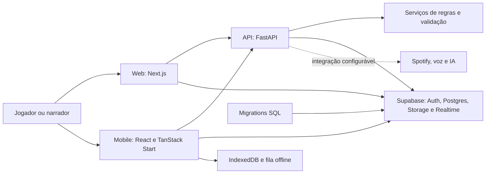
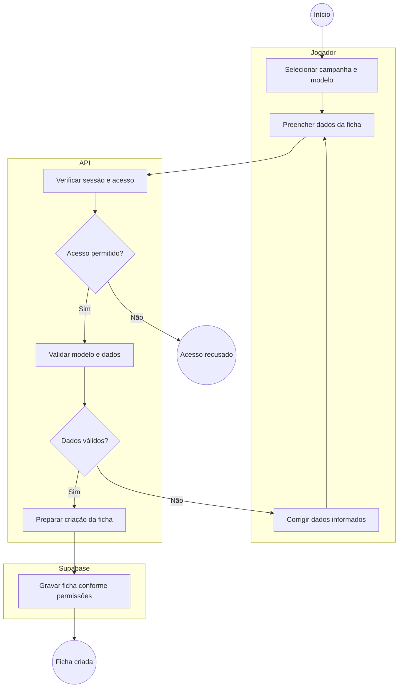
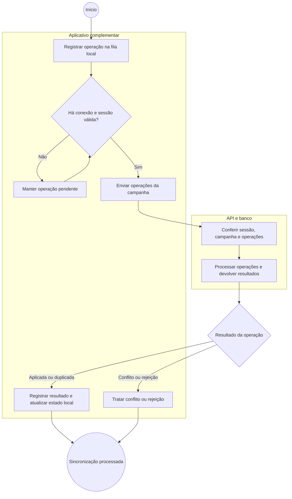
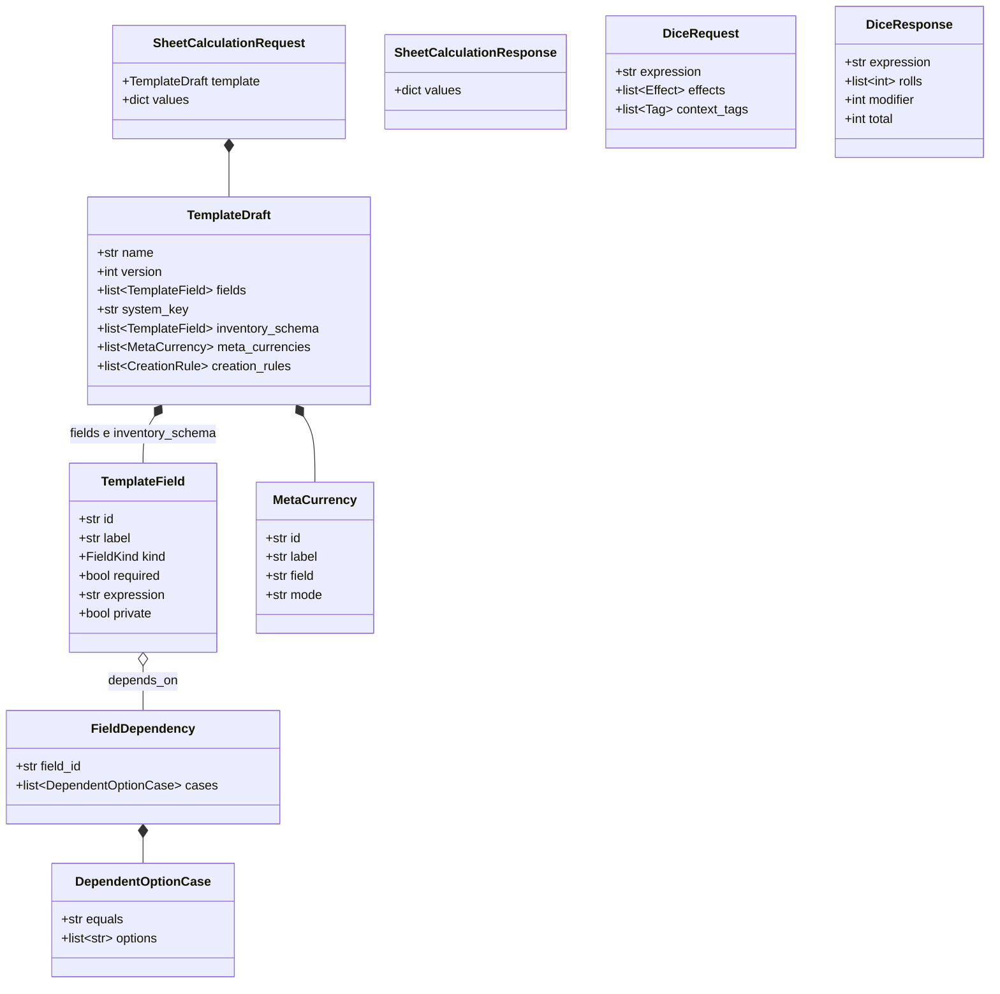
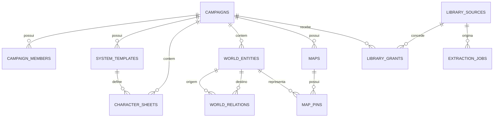

# RPG Atlas: documentação geral

Retrato do código local em 13/11/2026, na branch `feat/sotdl`. O repositório contém alterações sem commit. Este documento considera essas alterações; ele não comprova publicação nem funcionamento em produção.

## O que foi criado

O RPG Atlas organiza campanhas e fichas de RPG em uma interface web e em um aplicativo complementar. A API executa cálculos e regras. O Supabase fornece autenticação, dados e recursos de sincronização.

| Área | Recursos encontrados | Limites |
| --- | --- | --- |
| Campanhas | Membros, papéis, convites, diário, biblioteca e entidades do mundo. | O acesso depende das políticas instaladas no banco. |
| Fichas | Modelos, criação guiada, valores calculados, histórico, restauração, inventário e recursos. | Os catálogos e regras variam por sistema. |
| Sistemas | Vampiro V5 e V3, Caçador, O Um Anel v3, Shadow of the Demon Lord e Demon: The Fallen têm componentes ou serviços próprios. | A existência de código não demonstra cobertura integral dos livros. |
| Mesa | Rolagens, modificadores, mapas 2D, cenas e acompanhamento da crônica. | A visibilidade exige conferência com contas de papéis distintos. |
| O Um Anel | Construtor, Companhia e fluxo offline específico. | Validação autenticada hospedada pendente no registro de entrega. |
| Comunidade | Marketplace de modelos com publicação, importação e revisão. | Aplicação remota das migrations não foi verificada nesta leitura. |
| Mobile | Interface React, cache local e fila de sincronização. | Teste em Android físico permanece pendente no registro de 13/11. |
| Integrações | Existem rotas de Spotify, sessões de voz e assistência de IA. | Configuração e funcionamento externo não foram verificados. Algumas rotas de IA podem estar desativadas por política. |

O registro [Conclusão das oito áreas](CONCLUSAO_OITO_AREAS_20261112.md) informa que a entrega segue aberta. Ele registra falhas intermediárias em testes de Caçador e correções em andamento. Os resultados anteriores às últimas alterações não são aceite final.

## Arquitetura

O desenho apresenta dependências encontradas no código local. A presença de uma integração não indica que o serviço esteja ativo.



| Caminho | Responsabilidade |
| --- | --- |
| `frontend/app/` | Rotas Next.js, acesso, campanhas, marketplace e entrada offline. |
| `frontend/components/` e `frontend/lib/` | Painéis, editor de mapas, cálculos e clientes de integração. |
| `mobile/src/` | Interface complementar, armazenamento local e sincronização. A pasta não comprova a instalação de um aplicativo nativo. |
| `backend/app/main.py` | Cria a aplicação e registra rotas e camadas de segurança. |
| `backend/app/routes/` | Endpoints por domínio. |
| `backend/app/services/` | Cálculo de fichas, dados, regras, sincronização e integrações. |
| `supabase/migrations/` | Evolução do schema, funções e políticas. |
| `supabase/tests/` | Testes SQL das regras do banco. |
| `shared/` | Artefatos compartilhados entre partes do projeto. |

### Percurso de uma ficha

1. O jogador escolhe um modelo disponível na campanha e preenche os campos.
2. A API recebe a solicitação de validação ou criação. `TemplateDraft` descreve campos, regras e recursos; os serviços conferem os valores.
3. A persistência depende das rotas, funções SQL e permissões configuradas no banco. A ficha guarda valores e versão.
4. Alterações concorrentes e restaurações seguem os contratos das rotas de fichas e das migrations correspondentes.

### Sincronização e segurança

O cliente mobile mantém uma fila local. As rotas `sync/push`, `sync/snapshot` e `sync/changes` compõem o protocolo de envio e leitura. O Um Anel possui uma entrada offline própria; consulte [a entrega de O Um Anel](UM_ANEL_V3_ENTREGA.md).

O código registra middleware de segurança, admissão compartilhada, auditoria e CORS. As migrations definem políticas de acesso no banco. Sua existência local não demonstra que estejam aplicadas no destino. Chaves privilegiadas pertencem ao backend, nunca às variáveis públicas do navegador.

## Processos de negócio em BPMN

Os diagramas a seguir apresentam uma leitura simplificada dos processos com símbolos BPMN representados em Mermaid: círculos marcam início ou fim, retângulos representam tarefas e losangos representam decisões exclusivas. São diagramas explicativos, não arquivos BPMN 2.0 executáveis. As linhas mostram a sequência das atividades; os blocos identificam os responsáveis.

### Criação de ficha



O percurso resume os endpoints de validação e criação em [sheets.py](../backend/app/routes/sheets.py) e as regras em [sheet_creation.py](../backend/app/services/sheet_creation.py). A validação antecipada e a criação são solicitações distintas. Erros de rede ou de persistência podem interromper o fluxo; o desenho não detalha todos os retornos HTTP.

### Sincronização de alterações offline



A API reconhece resultados `applied`, `duplicate`, `conflict`, `denied`, `invalid` e `dependency_failed`. Os detalhes estão em [mobile_sync.py](../backend/app/routes/mobile_sync.py) e no [registro de entrega](CONCLUSAO_OITO_AREAS_20261112.md). O desenho resume o fluxo; a resolução de conflitos depende do tipo de operação e do estado do cliente.

## Diagrama de classes

O diagrama apresenta modelos Pydantic da API. As relações representam campos declarados. Ele cobre o núcleo de modelos; rotas específicas declaram outros contratos em seus próprios arquivos.



Campos opcionais aparecem sem a notação de nulidade para manter o desenho legível. Os validadores e tipos completos estão em [models.py](../backend/app/models.py). As regras de criação estão em [creation_rules.py](../backend/app/services/creation_rules.py).

## Relações centrais do banco

Este recorte reflete as chaves estrangeiras da migration inicial. Migrations posteriores acrescentam dados e regras.



A [migration inicial](../supabase/migrations/20260930002251_rpg_core.sql) é a fonte deste recorte. O schema vigente exige a sequência completa de migrations e inspeção do banco de destino.

## API

O ponto de entrada [main.py](../backend/app/main.py) registra rotas de fichas, rolagens, marketplace, sincronização, crônica e integrações. A documentação interativa fica em `http://localhost:8000/docs` quando a API está em execução. O contrato OpenAPI fica em `/openapi.json`.

| Grupo | Caminho ou módulo | Finalidade |
| --- | --- | --- |
| Saúde e cálculos | `/health`, `/api/v1/dice/roll`, `/api/v1/sheets/calculate` | Saúde, rolagem e cálculo de ficha. |
| Fichas | `backend/app/routes/sheets.py` | Criação, edição, histórico e restauração. |
| Sistemas | `system_rolls.py`, `v5.py`, `hunter.py` | Regras e ações específicas. |
| Sincronização | `mobile_sync.py` | Envio de operações e leitura de alterações. |
| Comunidade | `marketplace.py` | Modelos, importação e moderação. |
| Integrações | `spotify.py`, `voice_sessions.py`, `ai_assistance.py` | Contratos para serviços externos, sujeitos a configuração. |

## Operação local

O [README](../README.md) descreve instalação em Windows com Node.js, Python 3.14 e projeto Supabase. Os arquivos de dependências fixam Next.js 16.4.3, React 19.2.3, FastAPI 0.128.0 e Pydantic 2.12.5. A versão declarada é `0.1.0`.

Na raiz do repositório:

```powershell
npm --prefix frontend ci
py -3.14 -m venv backend\.venv
backend\.venv\Scripts\python.exe -m pip install -r backend\requirements.txt
Copy-Item frontend\.env.example frontend\.env.local
```

Preencha `NEXT_PUBLIC_SUPABASE_URL`, `NEXT_PUBLIC_SUPABASE_PUBLISHABLE_KEY` e `NEXT_PUBLIC_API_URL` em `frontend/.env.local`. Configure `SUPABASE_URL`, `SUPABASE_PUBLISHABLE_KEY` e `CORS_ORIGINS` no processo da API. O [README](../README.md) contém os exemplos completos.

Execute `npm run dev` e `npm run dev:api` em terminais separados. A interface abre em `http://localhost:3000`. O Compose atual sobe apenas a interface web.

## Verificações

| Comando | Finalidade |
| --- | --- |
| `npm run lint` | Conferência de tipos da interface web. |
| `npm run test:web` | Testes de domínio web. |
| `npm run test:api` | Testes da API pelo script PowerShell. |
| `npm run test:db` | Testes de banco local. |
| `npm run test:mobile` | Testes selecionados de sincronização e paridade mobile. |
| `npm run test:mobile:ui` | Testes de interface mobile. |
| `npm run build` | Build web. |
| `npm run build:mobile` | Build mobile. |

Os comandos estão em [package.json](../package.json). Nenhum teste foi executado para produzir esta documentação. Antes de aplicar migrations, confira o destino e o histórico real do banco. O registro de 13/11 relata falha na consulta de migrations e pendência de staging; ele não comprova o estado atual hospedado.

Para problemas de autenticação, confira a URL do Supabase, a chave publicável, a sessão e as políticas instaladas. Erros 429 podem indicar limite de concorrência ou de requisições; consulte [concorrência da API](API_CONCURRENCY.md).

## Documentos relacionados

O [README](../README.md) e os documentos específicos em `docs/` preservam instruções e histórico. Alguns trechos antigos podem divergir do código atual: o README descreve Spotify limitado a links, enquanto o backend contém rotas OAuth e de controle. A existência das rotas não confirma ativação externa.
